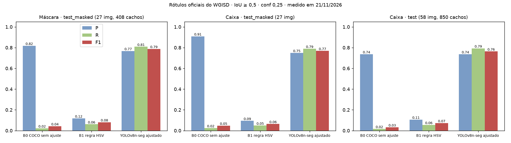
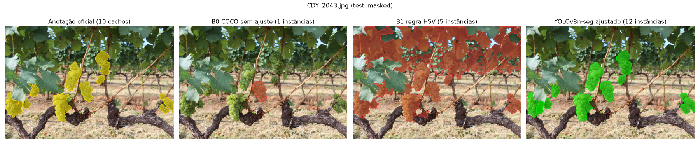

# E2 — Dados preparados e primeira adaptação

**Projeto:** SmartVine (G02) — segmentação de cachos e medição de bagas de uva com YOLOv8n-seg no WGISD  
**Equipe:** Marilio Cavalcanti de Moura · José Antonio  
**Datas:** 22/11/2026 (versionamento no Git, Pull Request) · 23/11/2026 (alinhamento com o professor)

Este repositório reúne a entrega da E2: o notebook usado no treino, os dados, os pesos gerados, os baselines e os resultados.

## Estrutura do repositório

```
g02-smartvine-ia/
├── README.md                     # este documento (entrega completa da E2)
├── RELATORIO_PROGRESSO.md        # relato curto para o alinhamento com o professor
├── PR_E2.md                      # texto do Pull Request
├── requirements.txt
├── notebooks/
│   └── uva_testes_bagas.ipynb    # notebook usado: preparação, treino, bagas, inferência e ONNX
├── data/
│   ├── README.md                 # origem e licença dos dados
│   ├── imagens/                  # só README: onde obter as 300 imagens do WGISD (não versionadas)
│   ├── labels/                   # só README: formato e origem das labels (não versionadas)
│   └── b1_ajuste.txt             # 23 imagens de treino usadas para ajustar o baseline B1
├── src/                          # avaliação: evaluate, baseline_hsv, metrics, berries
├── weights/
│   ├── README.md                 # hashes e licenças
│   └── best.pt · best.onnx       # modelo gerado no treino
└── resultados/
    ├── metricas/                 # JSON/CSV de B0, B1 e do modelo ajustado
    ├── figuras/                  # comparação entre métodos e exemplo qualitativo
    ├── treino_ft0/               # args.yaml, results.csv, curvas e matrizes do treino
    └── bagas/                    # saída do módulo de bagas
```

---

## Sumário

1. [Dados: limpeza, rotulagem, pré-processamento e partições](#1-dados)
2. [Baseline nas mesmas condições de teste](#2-baseline)
3. [Fine-tuning inicial](#3-fine-tuning-inicial)
4. [Resultados, limitações e próximo passo](#4-resultados-limitações-e-próximo-passo)
5. [Instruções de execução](#5-instruções-de-execução)
6. [Origem dos dados, pesos e licenças](#6-origem-dos-dados-pesos-e-licenças)
7. [Checklist do material esperado](#7-checklist-do-material-esperado)

---

## 1. Dados

### 1.1 Origem

| Item | Valor |
|---|---|
| Conjunto | Embrapa Wine Grape Instance Segmentation Dataset (WGISD) |
| Autores | Santos, T. T.; de Souza, L. L.; dos Santos, A. A.; Avila, S. |
| Repositório | https://github.com/thsant/wgisd |
| DOI | [10.5281/zenodo.3361736](https://doi.org/10.5281/zenodo.3361736) |
| Licença | CC BY-NC 4.0 (uso não comercial, com atribuição) |
| Conteúdo | 300 imagens, 5 variedades (CDY, CFR, CSV, SVB, SYH) |

Detalhes em [`data/README.md`](data/README.md).

### 1.2 Limpeza

Não foi necessária limpeza: as imagens e as labels vieram prontas do repositório. O notebook ([`uva_testes_bagas.ipynb`](notebooks/uva_testes_bagas.ipynb), seções 1 e 2) só confere se as pastas `images/` e `labels/` existem e se cada imagem listada em `train.txt` e `test.txt` está na pasta. Resultado: **300 imagens encontradas**, nenhuma ausente.

### 1.3 Rotulagem

A rotulagem veio do repositório: uma label YOLO-seg (`.txt`) por imagem, com os polígonos de cada cacho e uma classe (cacho de uva). Nenhuma anotação foi feita ou alterada pela equipe. Formato e origem em [`data/labels/README.md`](data/labels/README.md).

Na avaliação ([`src/evaluate.py`](src/evaluate.py)) a referência é a anotação original do WGISD: caixas (`.txt`) nas 58 imagens de `test.txt` e máscaras (`.npz`) nas 27 imagens de `test_masked.txt`.

> As imagens e labels **não são versionadas** neste repositório (tamanho e licença CC BY-NC 4.0). Elas são obtidas do repositório oficial do WGISD conforme a §5.

### 1.4 Pré-processamento

Feito pelo Ultralytics durante o treino (valores em [`args.yaml`](resultados/treino_ft0/args.yaml)):

- letterbox para 640 px e normalização;
- augmentações: HSV (h 0,015 · s 0,7 · v 0,4), translação 0,1, escala 0,5, flip horizontal 0,5, mosaic 1,0 (desligado nas 10 épocas finais), RandAugment e random erasing 0,4.

### 1.5 Partições

Foram usadas as partições originais do repositório, como no artigo (Santos et al., 2020):

| Partição | Imagens | Arquivo |
|---|---|---|
| Treino | **242** | `train.txt` |
| Teste | **58** | `test.txt` |

No notebook (seção 2), essas listas são convertidas em `yolo_train.txt` e `yolo_test.txt` com os caminhos completos das imagens.

**Justificativa:** é o mesmo particionamento do artigo-base, o que permite comparar com a literatura. A divisão é por imagem e nenhuma imagem aparece nas duas listas.

**Validação (protocolo equivalente):** o WGISD não traz partição de validação, e nesta primeira execução não foi criada uma. No `wgisd.yaml`, o campo `val` aponta para `yolo_test.txt`, então as métricas por época do Ultralytics (`results.csv`) são calculadas no próprio teste e servem **apenas para monitorar** o treino. Isso não alterou a escolha do modelo:

- não houve early stopping (as 50 épocas rodaram até o fim, `patience = 20`);
- o `best.pt` é a **época 50**, a última, que também é a de maior *fitness* no `results.csv`; o checkpoint seria o mesmo sem validação;
- nenhum hiperparâmetro do FT-0 foi escolhido olhando o teste.


---

## 2. Baseline

### 2.1 Referências avaliadas

| ID | Descrição | Ajuste |
|---|---|---|
| **B0** | YOLOv8n-seg pré-treinado no COCO, **sem ajuste** (qualquer detecção conta como cacho) | nenhum |
| **B1** | Regra de cor HSV + morfologia + componentes conexos | grade de 32 combinações escolhida em 23 imagens de treino ([`data/b1_ajuste.txt`](data/b1_ajuste.txt)) |

Melhor configuração do B1 ([`b1_hsv_params.json`](resultados/metricas/b1_hsv_params.json)): H verde 20–50, S ≥ 80, V escuro ≤ 60, S escuro ≥ 30, kernel 13, área mínima 0,2% da imagem. F1 nas imagens de ajuste = 0,079.

### 2.2 Como foi gerado

- **Código:** [`src/evaluate.py`](src/evaluate.py) roda os três métodos (B0, B1 e o modelo ajustado) com o mesmo procedimento. [`src/baseline_hsv.py`](src/baseline_hsv.py) implementa a regra HSV e a busca em grade. [`src/metrics.py`](src/metrics.py) faz o casamento e calcula P, R e F1.
- **Comando:** `python src/evaluate.py --wgisd ../wgisd --tune-b1 --methods b0 b1 ft --weights weights/best.pt`
- **Ambiente:** CPU Intel Xeon 2,9 GHz (2 vCPU), Python 3.13, ultralytics 8.4.216. Data: 21/11/2026.
- **Saídas:** [`resultados/metricas/`](resultados/metricas/) (um JSON por método e conjunto, mais `comparacao.csv`) e as figuras em [`resultados/figuras/`](resultados/figuras/).

### 2.3 Condições de teste (as mesmas para todos os métodos)

- **Conjuntos:** as 58 imagens de `test.txt` e, dentro delas, as 27 de `test_masked.txt` .
- **Casamento:** um-para-um guloso por confiança, IoU ≥ 0,5.
- **Inferência:** 640 px, `conf = 0,25`, máscaras na resolução original.

---

## 3. Fine-tuning inicial

### 3.1 Código e configuração

| Item | Arquivo |
|---|---|
| Notebook usado no treino | [`notebooks/uva_testes_bagas.ipynb`](notebooks/uva_testes_bagas.ipynb) |
| Configuração exata do treino | [`resultados/treino_ft0/args.yaml`](resultados/treino_ft0/args.yaml) |

O notebook tem 5 etapas:

1. **Setup:** caminhos, checagem da GPU e das pastas `images/` e `labels/`.
2. **Preparação do dataset:** gera `yolo_train.txt` e `yolo_test.txt` a partir de `train.txt` e `test.txt`.
3. **Treino:** `YOLO('yolov8n-seg.pt').train(...)` com os hiperparâmetros da §3.3.
4. **Bagas:** algoritmo geométrico que localiza as bagas dentro de cada máscara de cacho e mede o diâmetro.
5. **Análise, inferência e exportação:** análise das bagas por cacho, inferência em imagens novas (`conf = 0,50`) e exportação do `best.pt` para ONNX.

### 3.2 Parâmetros ajustados

- **Modelo base:** `yolov8n-seg.pt` (COCO).
- **Estratégia:** fine-tuning **completo**: backbone, neck e cabeça.
- **Cabeça:** trocada de 80 classes para **1** (cacho de uva).
- **Tamanho:** 3.258.259 parâmetros, 11,3 GFLOPs, 86 camadas (modelo fundido).

### 3.3 Hiperparâmetros

| Hiperparâmetro | Valor |
|---|---|
| Épocas | 50 (patience 20) |
| Batch | 32 |
| Resolução | 640 px |
| Otimizador | `optimizer=auto` → AdamW, lr 0,002, momentum 0,9 |
| `lr0` / `lrf` | 0,01 / 0,01 (com `optimizer=auto`, o Ultralytics ignora o `lr0` e usa o lr 0,002 acima) |
| Weight decay | 5e-4 |
| Warmup | 3 épocas (momentum 0,8, bias lr 0,1) |
| Perdas (pesos) | box 7,5 · cls 0,5 · dfl 1,5 |
| Máscaras | `overlap_mask=True`, `mask_ratio=4` |
| AMP | sim |
| Semente | 0, `deterministic=True` |
| `close_mosaic` | 10 |
| Workers | 8 |
| Augmentações | ver §1.4 |

### 3.4 Ambiente

| Item | Valor |
|---|---|
| Sistema | Windows, ambiente virtual Python local (`env_uva`) |
| GPU | NVIDIA RTX 4000 Ada (20 GB), 1 dispositivo CUDA |
| CPU | Intel Xeon |
| Bibliotecas | Ultralytics 8.4 · pandas 2.3.3 · numpy 2.0.1 · opencv-python |
| Dados de treino | 242 imagens de `train.txt` |
| Tempo total | 0,053 h ≈ 189 s (50 épocas) |
| Inferência na GPU | 1,0 ms por imagem (+ 0,1 ms de pré e 1,6 ms de pós-processamento) |
| Checkpoint | época 50 (`weights/best.pt`) |

### 3.5 Evidências de execução

- **Log por época:** [`resultados/treino_ft0/results.csv`](resultados/treino_ft0/results.csv) (50 linhas: perdas, métricas e taxa de aprendizado).
- **Curvas e matrizes:** [`resultados/treino_ft0/figuras/`](resultados/treino_ft0/figuras/) (`results.png`, curvas P/R/F1/PR de caixa e máscara, matriz de confusão, amostras de batch).
- **Saída completa do treino:** no próprio notebook, célula da seção 3.
- **Pesos:** [`weights/best.pt`](weights/) e `best.onnx`.

| Época | box_loss | seg_loss | cls_loss | dfl_loss | Tempo acumulado (s) |
|---|---|---|---|---|---|
| 1 | 2,308 | 4,799 | 3,502 | 1,863 | 7 |
| 10 | 1,346 | 2,336 | 1,012 | 1,090 | 39 |
| 20 | 1,247 | 2,095 | 0,886 | 1,062 | 75 |
| 30 | 1,183 | 1,967 | 0,796 | 1,038 | 109 |
| 40 | 1,135 | 1,891 | 0,727 | 1,007 | 144 |
| 50 | 1,032 | 1,680 | 0,659 | 0,972 | 189 |

Todas as perdas caem de forma consistente. A `seg_loss` cai 65% e a `cls_loss` 81% entre a primeira e a última época.


---

## 4. Resultados, limitações e próximo passo

### 4.1 Resultados medidos (21/11/2026)

Condições da §2.3: IoU ≥ 0,5, `conf = 0,25`, 640 px.

| Método | test_masked (27 img, 408 cachos) · máscara P / R / **F1** | test_masked · máscara mAP50 / mAP50-95 | test (58 img, 850 cachos) · caixa P / R / **F1** | Erro médio de contagem (cachos/img, test) |
|---|---|---|---|---|
| B0: YOLOv8n-seg COCO sem ajuste | 0,818 / 0,022 / **0,043** | 0,117 / 0,049 | 0,737 / 0,016 / **0,032** | 14,33 |
| B1: regra HSV | 0,118 / 0,061 / **0,081** | — | 0,106 / 0,055 / **0,073** | 8,21 |
| **FT-0: YOLOv8n-seg ajustado** | 0,767 / 0,809 / **0,788** | **0,857 / 0,544** | 0,737 / 0,793 / **0,764** | **2,16** |

Contagens brutas (TP / FP / FN):

| Método | test_masked · máscara | test_masked · caixa | test · caixa | s/img em CPU (test_masked · test) |
|---|---|---|---|---|
| B0 | 9 / 2 / 399 | 10 / 1 / 398 | 14 / 5 / 836 | 1,22 · 0,12 |
| B1 | 25 / 187 / 383 | 20 / 192 / 388 | 47 / 395 / 803 | 0,33 · 0,13 |
| FT-0 | 330 / 100 / 78 | 322 / 108 / 86 | 674 / 241 / 176 | 0,34 · 0,14 |

mAP do FT-0 em caixa no `test_masked`: mAP50 0,868 · mAP50-95 0,592.

Fontes: [`comparacao.csv`](resultados/metricas/comparacao.csv), [`map_test_masked_ultralytics.json`](resultados/metricas/map_test_masked_ultralytics.json) e os JSON de cada método em [`resultados/metricas/`](resultados/metricas/).





### 4.2 Módulo de bagas

Saída em [`resultados/bagas/`](resultados/bagas/) para o `frame-00067` do WGISD:

| Arquivo | Gerado por | Unidade |
|---|---|---|
| [`medidas_bagas.csv`](resultados/bagas/medidas_bagas.csv) | `src/berries.py` (sem `--px-per-mm`) | **px** (diâmetro médio, mínimo e máximo por cacho) |
| [`dados_frame-00067.csv`](resultados/bagas/dados_frame-00067.csv) | notebook, seção 5 | mm, com a escala do notebook (`PIXELS_POR_CM = 42`) |
| [`visual_frame-00067.jpg`](resultados/bagas/visual_frame-00067.jpg) | `src/berries.py` | imagem anotada |


Nessa imagem, o diâmetro medido varia de 20 px a 62 px entre as bagas detectadas.

### 4.3 Leitura

- **B0:** o COCO não tem a classe "uva". O modelo quase não detecta cachos (revocação de 0,02); a precisão alta vem de só 11 detecções em 27 imagens.
- **B1:** a regra de cor confunde folhas e cachos verdes (precisão de 0,12).
- **FT-0:** o fine-tuning eleva o F1 de máscara de 0,043 (B0) e 0,081 (B1) para **0,788**, e o erro de contagem cai de 14,3 e 8,2 para **2,2 cachos por imagem**. Precisão e revocação ficam equilibradas (0,77 / 0,81).
- **Literatura:** o Mask R-CNN de Santos et al. (2020) tem F1 ≈ 0,91 no WGISD. O protocolo não é idêntico, então esse valor é uma referência, não uma comparação direta.
- **Latência:** 1 ms por imagem na GPU e cerca de 0,14 s em CPU (2 vCPU), o que viabiliza a aplicação web.

### 4.4 Limitações

| # | Limitação |
|---|---|
| 1 | **Diâmetro das bagas:** o resultado principal está em px. Os valores em mm do notebook usam uma escala fixa (`PIXELS_POR_CM = 42`), sem calibração, e o módulo não foi comparado com anotações de bagas |
| 2 | **Sem partição de validação própria:** o `val` do treino é o próprio teste, usado só para monitorar (ver §1.5) |
| 3 | **Treino único:** o modelo foi treinado uma única vez (semente 0), sem repetição com outras sementes nem variação de hiperparâmetros |
| 4 | **Caminhos fixos no notebook** (`E:\Projeto_Uva\...`): precisam ser ajustados à mão (ver §5.1) |
| 5 | **Abaixo da referência da literatura:** F1 de máscara 0,788 contra ≈ 0,91 do Mask R-CNN de Santos et al. (protocolo não idêntico) |

Essas limitações estão registradas, mas não fazem parte do escopo da E3. Serão tratadas apenas se houver tempo após a aplicação web.

### 4.5 Próximo passo até a E3 (29/11/2026)

| Ação | Critério de pronto |
|---|---|
| Primeira versão da aplicação web com o `best.onnx` | Upload → máscara → tabela CSV |


---

## 5. Instruções de execução

### 5.1 Treino (notebook `uva_testes_bagas.ipynb`)

1. Crie o ambiente: `python -m venv env_uva` e `pip install -r requirements.txt`.
2. Baixe o WGISD (`git clone --depth 1 https://github.com/thsant/wgisd.git`) e organize os dados (as pastas [`data/imagens/`](data/imagens/) e [`data/labels/`](data/labels/) deste repositório só documentam a origem; os arquivos não são versionados):
   - imagens `.jpg` de `wgisd/data/` em `<PASTA_LOCAL>/images/`;
   - labels YOLO-seg (`.txt`, formato em [`data/labels/README.md`](data/labels/README.md)) em `<PASTA_LOCAL>/labels/`;
   - `train.txt` e `test.txt` do WGISD em `<BASE_DATASETS>/`.
3. Na seção 1 do notebook, ajuste `PROJETO_DIR`, `PASTA_LOCAL` e `BASE_DATASETS` (no original: `E:\Projeto_Uva\...`).
4. Rode a seção 2: ela gera `yolo_train.txt`, `yolo_test.txt` e o `wgisd.yaml` em `PROJETO_DIR` (`train: yolo_train.txt`, `val: yolo_test.txt`, classe `0: uva`). Ver §1.5 sobre o uso do teste como `val`.
5. Rode as células na ordem: setup → preparação → treino → bagas → análise/inferência → exportação ONNX.
6. Os pesos saem em `PROJETO_DIR/wgisd_treino_baga/weights/best.pt` (cópia em [`weights/best.pt`](weights/)).

### 5.2 Baselines e avaliação (a partir da raiz do repositório)

```bash
pip install -r requirements.txt

# Repositório do WGISD com train.txt, test.txt e test_masked.txt
git clone --depth 1 https://github.com/thsant/wgisd.git ../wgisd

# B0, B1 e modelo ajustado nas mesmas condições
python src/evaluate.py --wgisd ../wgisd --tune-b1 --methods b0 b1 ft --weights weights/best.pt

# Módulo de bagas (diâmetro em px; use --px-per-mm se houver escala)
python src/berries.py --weights weights/best.pt --source ../wgisd/extra/video_demo_frames/frame-00067.jpg
```

---

## 6. Origem dos dados, pesos e licenças

| Item | Onde | Licença |
|---|---|---|
| WGISD (imagens, listas e anotações) | https://github.com/thsant/wgisd; registro em [`data/README.md`](data/README.md) | CC BY-NC 4.0 |
| Imagens e labels usadas | não versionadas; origem documentada em [`data/imagens/`](data/imagens/README.md) e [`data/labels/`](data/labels/README.md) | CC BY-NC 4.0 |
| `weights/best.pt` (6,8 MB) · `best.onnx` (13,4 MB) | nesta pasta | AGPL-3.0 (Ultralytics) + uso não comercial (WGISD) |

Hashes e detalhes em [`weights/README.md`](weights/README.md).

---

## 7. Checklist do material esperado

- [x] Repositório atualizado (notebook, código de avaliação, relatórios nesta pasta)
- [x] Limpeza, rotulagem e pré-processamento documentados (§1.2–1.4)
- [x] Partições de treino e teste justificadas, com o protocolo de validação explicado (§1.5)
- [x] Baseline comparável avaliado nas mesmas condições de teste (§2, §4.1)
- [x] Fine-tuning inicial: código, configuração, parâmetros ajustados, hiperparâmetros e ambiente (§3.1–3.4)
- [x] Evidências de execução: log, curvas e métricas (§3.5)
- [x] Primeiros resultados, limitações e próximo passo até a E3 (§4)
- [x] Instruções de execução (§5)
- [x] Registro da origem dos dados (§1.1, §6)
- [x] Pesos entregues de forma permitida pela licença (§6)
- [x] Relatório de progresso: [`RELATORIO_PROGRESSO.md`](RELATORIO_PROGRESSO.md)
- [x] Texto do Pull Request: [`PR_E2.md`](PR_E2.md)

=======
# SmartVine: identificação de cachos e medição do diâmetro das bagas de uva com YOLOv8n-seg

- **Disciplina:** Tópicos Avançados em Inteligência Artificial — Projeto Aplicado de IA
- **Professor:** Marcondes Ricarte • 2026.2
- **Entrega:** E1 • Definição do projeto (versionamento, 17/11/2026)
- **Equipe:** Marilio Cavalcanti de Moura · José Antonio

### Links principais

| Item | Link |
|---|---|
| **Artigo-base (DOI)** | [10.1016/j.compag.2020.105247](https://doi.org/10.1016/j.compag.2020.105247) |
| **Artigo-base (versão aberta)** | [arXiv:1907.11819](https://arxiv.org/abs/1907.11819) |
| **Base de dados (GitHub)** | [github.com/thsant/wgisd](https://github.com/thsant/wgisd) |
| **Base de dados (DOI)** | [10.5281/zenodo.3361736](https://doi.org/10.5281/zenodo.3361736) |
| **Notícias que sustentam o problema** | Ver [§1.4](#14-evidência-inicial) |

---

## 1. Problema e beneficiário

> **O problema em uma frase:** o produtor de uva de mesa precisa saber **qual é o diâmetro (calibre) das bagas** para decidir o manejo e o ponto de colheita, e hoje essa medida é feita à mão. Até em **Petrolina (PE)**, no polo que responde por 95% da uva de mesa do Brasil, uma das maiores produtoras relatou medir a baga com **anel de medida**, com cerca de 30% de margem de erro (Folha de Pernambuco, 2024). O pequeno produtor mede com paquímetro e não tem acesso à automação com drones e sensores que começa a ser testada nas grandes fazendas do polo.

### 1.1 Cliente
**Parreiral da Serra, Sítio Jussaral, Natuba (PB).** É uma propriedade comercial de uvas de mesa (variedades Vitória e Verde). Representa os pequenos e médios produtores do Nordeste que estão **fora do polo do Vale do São Francisco** e não têm acesso aos projetos de automação testados nas grandes fazendas de lá (ver §1.4).

### 1.2 Perfil do usuário
- **Usuário principal:** o viticultor ou o funcionário de campo da propriedade, que acompanha o desenvolvimento dos frutos no dia a dia.
- **Usuário secundário:** o agrônomo ou consultor que usa o diâmetro das bagas para recomendar raleio, aplicação de reguladores, irrigação e data de colheita.

### 1.3 Necessidade: o diâmetro da baga, não a quantidade
Na uva de mesa, o que define o valor comercial do cacho é o **calibre da baga** (diâmetro em mm). A classificação para venda, o preço e as decisões de manejo dependem dele: raleio de bagas, uso de reguladores de crescimento, ajuste de irrigação e ponto de colheita. Saber *quantas* bagas o cacho tem importa pouco. O que o produtor precisa saber é **se elas estão crescendo até o calibre esperado**, e a tempo de corrigir o manejo.

Hoje há dois cenários:

| Cenário | Como o calibre é aferido | Limitação |
|---|---|---|
| **Grandes fazendas do polo de Petrolina (PE)** | Medição manual com **anel de medida**, relatada pela Agrivale em 2024. Em paralelo, projetos de pesquisa testam drones, câmeras, sensores IoT e IA para **contar e categorizar cachos** | O anel tem cerca de 30% de margem de erro. As fontes sobre a automação descrevem contagem de cachos, não medição do diâmetro das bagas, e ela depende de drones, rede de sensores e parceria com empresa e universidade |
| **Pequeno produtor (Natuba, PB)** | Medição manual com **paquímetro**, baga por baga, em poucos cachos | Lenta, com amostra pequena, dependente de quem mede e sem histórico padronizado |

Na propriedade do cliente, a medição manual:
- cobre **poucos cachos** e é feita com **baixa frequência**;
- muda conforme a pessoa que mede;
- não gera um histórico por talhão e por safra;
- deixa o produtor **sem saber como está o calibre** entre uma medição e outra, com risco de perder o momento certo de intervir.

### 1.4 Evidência inicial
- **Observação do processo atual:** visita de campo ao Parreiral da Serra entre 15 e 22/07/2026. Foram registradas 4 imagens RGB de cachos (smartphone Samsung Galaxy A71, 64 MP) em condições reais de cultivo, com iluminação natural, oclusão por folhas e sobreposição de cachos.
- **Contexto regional:** em Petrolina, a medição da baga também foi relatada como manual, e a automação noticiada vem de projetos de pesquisa em grandes fazendas (ver notícias abaixo).
- **Literatura:** a dependência de medição manual e pouco escalável é relatada na viticultura de precisão (Ammoniaci et al., 2021; Ariza-Sentís et al., 2023).

#### Notícias e fontes sobre Petrolina

| Fonte | Data | O que a fonte diz | O que isso mostra para o projeto |
|---|---|---|---|
| **Folha de Pernambuco** — [Produtora de uva Agrivale, de Petrolina, aposta em soluções tecnológicas para crescer](https://www.folhape.com.br/economia/s/319058/) | 26/02/2024 | A Agrivale, uma das maiores produtoras de uva de mesa do país, levou ao evento Desafios.Day o problema de conseguir "a medição exata do tamanho da baga". A medição é feita com **anel de medida** e serve para estimar o volume da colheita e planejar embalagem e mão de obra. A empresa também cita escassez de mão de obra no campo e no packing house | A medição do calibre é um problema em aberto até para uma grande produtora, e ela procura uma solução tecnológica |
| **Netcon Americas** (blog da empresa) — [Projeto MAI/DAI: parceria Scinet, Netcon Americas e UFRJ na Fazenda IP Fittipaldi](https://netconamericas.com/blog/projeto-mai-dai-tecnologia-e-agricultura/) | 06/11/2024 | Em uma fazenda de Petrolina, o projeto instalou rede de sensores LoRaWAN e estação meteorológica, e usa vídeos de **drone** com aprendizado de máquina para **contar e categorizar cachos** | A automação noticiada no polo depende de drone, sensores e parceria com empresa e universidade |
| **Netcon Americas** (blog da empresa) — [Do solo às videiras: como a inteligência artificial cria uma nova perspectiva para a produção agrícola](https://netconamericas.com/blog/do-solo-as-videiras-como-a-inteligencia-artificial-cria-uma-nova-perspectiva-para-a-producao-agricola/) | 04/09/2026 | A contagem automática de cachos por visão computacional foi validada na Fazenda IP Fittipaldi com as variedades Sugar Crisp e **BRS Vitória**, para estimar a produtividade da safra | A mesma variedade do cliente (Vitória) já é alvo de visão computacional, mas para contar cachos |

> "A gente quer uma solução para isso porque hoje se tem 70% assertividade. Isso dá uma margem de erro de 30%, que ainda é muito grande." — Isabela Bourbon, gerente geral de Finanças da Agrivale, à Folha de Pernambuco (26/02/2024).

As duas publicações da Netcon Americas são textos do blog da própria empresa, e não reportagens independentes.

### 1.5 Benefício esperado
Permitir que o **próprio produtor**, só com **uma foto de celular**, obtenha uma **estimativa automática e padronizada do diâmetro das bagas** de cada cacho, sem precisar de máquina dedicada. Com isso:
- o calibre passa a ser acompanhado **em mais cachos e com mais frequência**;
- a medida deixa de depender de quem mede;
- a propriedade passa a ter um **histórico padronizado** do calibre por talhão e por safra.

A identificação dos cachos e a localização das bagas visíveis são **etapas intermediárias**: servem para encontrar cada baga antes de medir o diâmetro dela.

---

## 2. Solução e escopo

### 2.1 Entrada, processamento e saída

| Etapa | Descrição |
|---|---|
| **Entrada** | Imagem RGB de uma fileira ou de um cacho (foto de celular ou quadro de vídeo), com opção de informar uma referência de escala (mm ↔ px). |
| **Processamento 1 — IA** | O **YOLOv8n-seg com fine-tuning no WGISD** segmenta cada cacho por instância (máscara + caixa + confiança). |
| **Processamento 2 — geométrico** | Dentro de cada máscara: CLAHE, suavização gaussiana, Transformada Circular de Hough, filtro por distância à borda (Transformada de Distância) e escore de suporte de borda (Canny), seguidos de supressão de sobreposição. |
| **Saída (principal)** | **Diâmetro estimado das bagas por cacho**: média, mínimo, máximo e distribuição. O valor sai em mm quando há referência de escala e em px quando não há. |
| **Saída (apoio)** | Imagem anotada (cachos e bagas medidas) e tabela por cacho com ID, confiança, área e nº de bagas usadas na medição, exportável em CSV/JSON. |

### 2.2 Fluxo de uso

```
Usuário envia foto ──► Pré-processamento (resize 640, normalização)
                   ──► YOLOv8n-seg (ONNX) ──► máscaras dos cachos
                   ──► Módulo geométrico por cacho ──► bagas + diâmetros
                   ──► Tela de resultados (imagem anotada + tabela + download CSV)
```

### 2.3 O que **será** implementado até a apresentação (07/12)
- [x] Conversão do WGISD (máscaras `.npz`) para o formato YOLO-seg *(já testada pela equipe; será revisada e versionada)*
- [x] Partições sem vazamento (treino / validação / teste) documentadas
- [x] Baseline(s) avaliados nas mesmas condições de teste
- [x] Fine-tuning do YOLOv8n-seg com 5 sementes (média, desvio-padrão e IC95%)
- [x] Módulo geométrico de bagas com parâmetros escolhidos **apenas** nas partições de treino e validação
- [x] Exportação para ONNX e aplicação web (upload → inferência → resultado)
- [x] Avaliação final no teste do WGISD e aplicação exploratória às imagens de Natuba
- [x] Teste de uso com pelo menos um representante do público-alvo

### 2.4 O que **não será** implementado nesta disciplina
- Execução embarcada no ESP32-S3, quantização INT8 e nós IoT com sensores;
- Aquisição por drone (UAV) e rastreamento entre quadros de vídeo (a associação 3D do artigo-base);
- Detecção de pragas e doenças e previsão de safra;
- Validação física completa do diâmetro com paquímetro em grande amostra. Nesta disciplina, o diâmetro será apresentado como **estimativa relativa**, salvo se houver coleta com referência de escala até a E3.

### 2.5 Justificativa da solução
1. **Cliente:** o produtor precisa acompanhar o **calibre das bagas** sem depender de drones, redes de sensores ou equipamento dedicado, que hoje aparecem em projetos de grandes fazendas, como em Petrolina. A solução precisa funcionar com uma foto de celular.
2. **Processo atual:** a medição com paquímetro é lenta e amostral. Uma estimativa automática, mesmo aproximada, permite medir mais cachos e com mais frequência.
3. **Artigo-base:** Santos et al. (2020) mostram que a **segmentação por instância** é a formulação mais adequada para cachos de uva. Detectar com caixa não separa bem formas irregulares, e a segmentação semântica sofre com oclusão. Como o WGISD tem máscaras de cachos, mas não de bagas, a análise das bagas é feita por processamento geométrico dentro da máscara.
4. **Inovação em relação ao artigo-base:** o artigo identifica e segmenta os cachos, mas não mede as bagas. Aqui, a identificação do cacho e a medição do diâmetro das bagas funcionam **em conjunto**, no mesmo fluxo (ver §3.3).

---

## 3. Artigo-base

| Campo | Informação |
|---|---|
| **Título** | Grape detection, segmentation, and tracking using deep neural networks and three-dimensional association |
| **Autores** | Thiago T. Santos, Leonardo L. de Souza, Andreza A. dos Santos, Sandra Avila |
| **Ano / Veículo** | 2020 — *Computers and Electronics in Agriculture*, v. 170, 105247 |
| **DOI** | [10.1016/j.compag.2020.105247](https://doi.org/10.1016/j.compag.2020.105247) |

### 3.1 Método do artigo
- Criação do **WGISD**: 300 imagens, 4.432 cachos com caixa e 2.020 cachos com máscara, de 5 variedades. As máscaras foram anotadas com uma ferramenta interativa (watershed + casamento de grafos).
- **Etapa perceptiva:** comparação de **Mask R-CNN** (backbone ResNet + FPN, segmentação por instância) com **YOLOv2/YOLOv3** (detecção por caixa), todos com transfer learning a partir de pesos pré-treinados.
- **Avaliação:** precisão, revocação e **F1 em vários limiares de IoU**, separando detecção (caixa) e segmentação por instância (máscara). O melhor resultado foi **F1 ≈ 0,91** em segmentação por instância, no teste com 408 cachos.
- **Associação espacial:** rastreamento dos cachos entre quadros de vídeo usando *structure-from-motion* (associação 3D), para evitar contagem dupla.

### 3.2 Componentes utilizados e adaptados

| Componente do artigo | Uso no projeto |
|---|---|
| WGISD e seu particionamento oficial (`train_masked` / `test_masked`) | **Usado** como base de treino e teste |
| Formulação como segmentação por instância | **Usada** |
| Transfer learning a partir de pesos pré-treinados (COCO) | **Usado** (fine-tuning) |
| Mask R-CNN | **Substituído** pelo YOLOv8n-seg (ver §4.2) |
| Protocolo de métricas (P, R, F1 por limiar de IoU; caixa × máscara) | **Adaptado**: mantido e complementado com mAP@50 e mAP@50–95 |
| Rastreamento / associação 3D | **Não usado** nesta disciplina (fora de escopo) |
| Medição do diâmetro das bagas | **Não existe no artigo.** Contribuição própria: módulo geométrico (Hough + filtros) aplicado dentro das máscaras geradas pelo modelo |

### 3.3 Inovação em relação ao artigo-base
O artigo de Santos et al. (2020) para na identificação do cacho: ele detecta, segmenta e rastreia os cachos, mas **não mede as bagas**. Este projeto junta, em um único fluxo, duas etapas que o artigo não combina:

1. **Identificação do cacho:** o YOLOv8n-seg ajustado no WGISD gera a máscara de cada cacho.
2. **Medição das bagas:** dentro de cada máscara, o módulo geométrico localiza as bagas visíveis e estima o diâmetro delas.

As duas etapas trabalham em conjunto. A máscara do modelo limita a busca ao interior do cacho, o que reduz o risco de confundir folhas, ramos e fundo com bagas. Assim, **uma única foto de celular** entrega o cacho identificado e o calibre das bagas.

Em Petrolina, as iniciativas de automação noticiadas contam e categorizam cachos com drones e sensores em grandes fazendas, e a medição da baga foi relatada como manual, com anel de medida (ver §1.4). Nenhuma das fontes consultadas descreve a medição do diâmetro das bagas a partir de uma foto de celular, que é o que este projeto propõe.

---

## 4. Modelo pré-treinado

| Campo | Informação |
|---|---|
| **Nome / versão** | YOLOv8n-seg (Ultralytics YOLOv8, variante *nano*, segmentação) — biblioteca `ultralytics` 8.4.x |
| **Origem dos pesos** | `yolov8n-seg.pt`, publicado pela Ultralytics ([github.com/ultralytics/assets](https://github.com/ultralytics/assets/releases), baixado automaticamente pela biblioteca) |
| **Licença** | AGPL-3.0 (uso acadêmico e código aberto permitidos; o repositório do projeto seguirá licença compatível) |
| **Tarefa original** | Segmentação por instância no **COCO** (80 classes, sem classe "uva") |
| **Tamanho** | 3,26 M de parâmetros · ~11–12 GFLOPs · entrada 640×640 |
| **Relação com o artigo** | Mesma tarefa (segmentação por instância de cachos) e mesma estratégia (transfer learning de COCO para WGISD) |

### 4.1 O que será ajustado
Fine-tuning **completo** dos parâmetros (backbone, neck e cabeça de segmentação), trocando a cabeça de 80 classes por **1 classe (`grape_cluster`)**. Como ablação opcional, se houver tempo: congelar o backbone (`freeze=10`) e ajustar só neck e cabeça.

### 4.2 Por que não usar o mesmo modelo do artigo
O artigo usa Mask R-CNN, que **também** é um segmentador por instância treinado por transfer learning a partir do COCO. Escolhemos o YOLOv8n-seg porque:
1. **A correspondência metodológica se mantém:** a tarefa é a mesma (máscara por cacho), assim como a fonte dos pesos (COCO), o tipo de adaptação (fine-tuning) e o protocolo de avaliação (P/R/F1 por IoU em caixa e máscara).
2. **Viabilidade:** o modelo tem cerca de 3,3 M de parâmetros, contra ~44 M de um Mask R-CNN R101-FPN. Treina em minutos numa GPU comum e roda em CPU, o que se encaixa no prazo da disciplina e no requisito de baixo custo do cliente.
3. **Portabilidade:** a exportação para ONNX é nativa e já foi testada pela equipe (`best.onnx`, opset 19), o que facilita a aplicação web.
4. O próprio artigo já compara uma arquitetura de estágio único (YOLO) com uma de dois estágios (Mask R-CNN). Usar o YOLOv8-seg dá continuidade a essa comparação com uma versão moderna, agora com máscara.

---

## 5. Conjunto de dados-base

### 5.1 WGISD (treino, validação e teste)

| Campo | Informação |
|---|---|
| **Fonte** | Embrapa Wine Grape Instance Segmentation Dataset — [github.com/thsant/wgisd](https://github.com/thsant/wgisd) · Zenodo DOI [10.5281/zenodo.3361736](https://doi.org/10.5281/zenodo.3361736) |
| **Acesso** | Público, download direto (sem cadastro) |
| **Licença** | CC BY-NC 4.0: uso não comercial com atribuição (compatível com uso acadêmico) |
| **Formato** | Imagens `.jpg`; caixas em `.txt` (formato YOLO); máscaras de instância em `.npz`; listas de partição em `.txt` |
| **Volume** | 300 imagens, 4.432 cachos com caixa e **137 imagens com máscara (2.020 cachos)**: 110 imagens / 1.612 cachos em `train_masked` e 27 imagens / 408 cachos em `test_masked` |
| **Rótulos** | 1 classe (cacho) com máscara por instância. Há também anotações pontuais de bagas (111 imagens, 7.349 bagas), usadas para avaliar a contagem |
| **Variedades** | Chardonnay, Cabernet Franc, Cabernet Sauvignon, Sauvignon Blanc e Syrah |
| **Adequação ao problema** | Vinhedo comercial real em espaldeira, imagens frontais com câmera comum e iluminação natural, ou seja, o mesmo tipo de captura previsto para o cliente |

### 5.2 Base de campo — Natuba/PB (somente teste exploratório)
- 4 imagens RGB (variedades Vitória e Verde), obtidas com autorização do produtor em julho de 2026;
- **nunca** usadas em treino, seleção de época ou ajuste de hiperparâmetros;
- servem para avaliar **generalização qualitativa** num domínio diferente (uva de mesa, Nordeste e outro tipo de câmera). Se der tempo até a E3, serão ampliadas e receberão contagens manuais.

### 5.3 Protocolo de partição (sem vazamento)
- O `test_masked` oficial (27 imagens) fica **reservado** e só é usado na avaliação final.
- O `train_masked` (110 imagens) é dividido **por imagem** em treino (~88) e validação (~22), estratificado por variedade, com semente fixa e lista versionada no repositório.
- A validação é usada para early stopping, escolha de época e busca de parâmetros do módulo geométrico.
- **Correção em relação ao teste preliminar da equipe:** nele, o `test_masked` foi usado como validação interna durante o treino. Aqui, ele passa a ser **apenas** teste.

---

## 6. Plano de adaptação e avaliação

### 6.1 Configuração do fine-tuning (ponto de partida)

| Parâmetro | Valor |
|---|---|
| Inicialização | `yolov8n-seg.pt` (COCO) |
| Resolução | 640 × 640 |
| Épocas / early stopping | até 100 / patience 20 |
| Batch | 16–32 (conforme memória da GPU) |
| Otimizador | AdamW (lr inicial ≈ 0,002, weight decay 5e-4) |
| Data augmentation | HSV (0,015 / 0,7 / 0,4), translação 0,1, escala 0,5, flip horizontal 0,5, mosaic 1,0 (desligado nas 10 épocas finais) |
| Repetições | 5 sementes, com média, desvio-padrão e IC95% |

### 6.2 Baselines (mesmo conjunto de teste)

| # | Baseline | Objetivo |
|---|---|---|
| B0 | **YOLOv8n-seg pré-treinado sem ajuste** (COCO, inferência sem distinguir classe) | Mostrar o ganho real do fine-tuning |
| B1 | **Regra clássica:** limiarização em HSV + morfologia + componentes conexos | Mostrar o ganho em relação a uma solução sem aprendizado |
| B2 | *(Opcional)* fine-tuning com backbone congelado | Comparar custo e desempenho do ajuste parcial |
| Ref. | Resultado do Mask R-CNN no artigo (F1 ≈ 0,91) | Apenas **referência da literatura**: o protocolo não é idêntico, então não entra como comparação direta |

### 6.3 Métricas

| Componente | Métricas |
|---|---|
| Segmentação de cachos (caixa e máscara) | Precision, Recall, **F1 @ IoU 0,5** (como no artigo), **mAP@50** e **mAP@50–95** (principal) |
| Identificação de bagas | Precision, Recall e F1 (casamento um a um entre ponto anotado e círculo detectado); **MAE** da contagem por imagem |
| Diâmetro das bagas | Erro absoluto médio (mm) em relação ao paquímetro, em uma amostra pequena de bagas de Natuba, se houver coleta com referência de escala até a E3. Sem essa coleta, o diâmetro é reportado como estimativa relativa (px) |
| Aplicação | Latência de inferência em CPU (ONNX Runtime), tamanho do modelo e tempo total por imagem |
| Uso | Teste de tarefa com representante do público-alvo (concluiu a tarefa? entendeu a saída? feedback) |

### 6.4 Recursos computacionais
- **Treino:** GPU NVIDIA RTX 4000 Ada (20 GB), já disponível para a equipe; **plano B:** Google Colab (T4, gratuito).
- **Ambiente:** Python 3.10, PyTorch 2.5, Ultralytics 8.4, OpenCV, ONNX Runtime.
- **Aplicação:** web com inferência em CPU (ONNX). Não é preciso serviço pago.
- **Custo estimado:** cada execução de fine-tuning do YOLOv8n-seg com ~88 imagens leva poucos minutos nessa GPU, então as 5 sementes cabem com folga no prazo.

### 6.5 Riscos e mitigação

| Risco | Impacto | Mitigação |
|---|---|---|
| Base pequena (110 imagens com máscara) → sobreajuste | Médio | Data augmentation, early stopping na validação, 5 sementes para medir variância |
| Mudança de domínio (uvas de vinho no WGISD × uvas de mesa em Natuba) | Alto | Avaliação de campo apresentada como exploratória; limitação registrada; se possível, anotar algumas imagens de campo para teste |
| Bagas muito sobrepostas e ocluídas → contagem subestimada | Médio | Medir o MAE e analisar casos de falha; deixar claro que a contagem é de **bagas visíveis** |
| Diâmetro em mm depende da escala | Alto | Referência de escala por imagem; sem referência, informar o diâmetro como relativo (px) |
| Licenças (AGPL-3.0 do modelo; CC BY-NC do WGISD) | Baixo | Uso estritamente acadêmico e não comercial, com créditos no README |
| Indisponibilidade da GPU | Baixo | Colab como alternativa |

### 6.6 Divisão das atividades

| Atividade | Responsável |
|---|---|
| Preparação dos dados, partições e documentação da origem | Marilio Cavalcanti de Moura e José Antonio |
| Baselines B0/B1 e protocolo de avaliação | Marilio Cavalcanti de Moura e José Antonio |
| Fine-tuning, 5 sementes e análise estatística | Marilio Cavalcanti de Moura e José Antonio |
| Módulo geométrico de bagas e avaliação de contagem | Marilio Cavalcanti de Moura e José Antonio |
| Exportação ONNX e aplicação web | Marilio Cavalcanti de Moura e José Antonio |
| Teste de uso com o produtor e relatório final | Marilio Cavalcanti de Moura e José Antonio |

Todas as atividades são feitas em conjunto pelos dois integrantes, e ambos dominam todo o pipeline para a defesa técnica.

### 6.7 Cronograma

| Entrega | Data | Resultado previsto |
|---|---|---|
| **E1 — Definição** | 11/11 | Este documento (README) |
| **E2 — Modelo e dados** | 22/11 (PR) · 23/11 | Script de conversão e partições, baselines B0/B1, primeira execução de fine-tuning com logs e curvas |
| **E3 — Aplicação** | 29/11 (PR) · 30/11 | 5 sementes consolidadas, módulo de bagas avaliado, ONNX + app web, teste com usuário |
| **E4 — Apresentação** | 07/12 | Demo completa, slides, relatório técnico e pesos disponibilizados |

---

## 7. Viabilidade

- **Pesos acessíveis:** `yolov8n-seg.pt` é público e baixado automaticamente.
- **Dados acessíveis:** o WGISD é público, a conversão para YOLO-seg já foi testada pela equipe e as imagens de campo já foram coletadas com autorização.
- **Treino viável:** o modelo é pequeno e a GPU já está disponível. Um teste preliminar da equipe já chegou a mAP@50 (máscara) de 0,856 e F1 de 0,825, o que mostra que o caminho funciona. Esses números **serão refeitos** na disciplina com o novo protocolo sem vazamento, e só os resultados novos serão reportados como resultados da disciplina.
- **Demonstração viável:** a exportação para ONNX e a inferência em CPU já foram testadas.

---

## 8. Estrutura prevista do repositório

Nesta entrega (E1) vai apenas este README. As pastas abaixo entram a partir da E2.

```
smartvine-ia/
├── README.md              # este documento (atualizado a cada entrega)
├── data/
│   ├── README.md          # origem, licença e instruções de download do WGISD
│   └── splits/            # listas train/val/test versionadas
├── scripts/
│   ├── convert_wgisd.py   # .npz → YOLO-seg
│   └── make_splits.py
├── baselines/             # B0 (COCO sem ajuste) e B1 (regra HSV)
├── training/              # configs, logs e curvas do fine-tuning
├── berries/               # módulo geométrico de bagas
├── app/                   # aplicação web + modelo ONNX
└── reports/               # relatórios de progresso (E2, E3) e final
```

---

## Referências

- AMMONIACI, M. et al. State of the art of monitoring technologies and data processing for precision viticulture. *Agriculture*, 2021.
- ARIZA-SENTÍS, M. et al. Object detection and tracking in precision farming: a systematic review. *Computers and Electronics in Agriculture*, 2023.
- CARVALHO, C. A. Produtora de uva Agrivale, de Petrolina, aposta em soluções tecnológicas para crescer. *Folha de Pernambuco*, Recife, 26 fev. 2024. Disponível em: https://www.folhape.com.br/economia/s/319058/. Acesso em: 11 nov. 2026.
- JOCHER, G.; CHAURASIA, A.; QIU, J. *Ultralytics YOLOv8*. 2023. Disponível em: https://github.com/ultralytics/ultralytics.
- ROCHA, W. Projeto MAI/DAI – Tecnologia e Agricultura de Mãos Dadas: parceria Scinet, Netcon Americas e Universidade Federal do Rio de Janeiro na Fazenda IPFittipaldi. *Netcon Americas*, 6 nov. 2024. Disponível em: https://netconamericas.com/blog/projeto-mai-dai-tecnologia-e-agricultura/. Acesso em: 11 nov. 2026.
- ROCHA, W. Do solo às videiras: como a inteligência artificial cria uma nova perspectiva para a produção agrícola. *Netcon Americas*, 4 set. 2026. Disponível em: https://netconamericas.com/blog/do-solo-as-videiras-como-a-inteligencia-artificial-cria-uma-nova-perspectiva-para-a-producao-agricola/. Acesso em: 11 nov. 2026.
- SANTOS, T. T.; DE SOUZA, L. L.; DOS SANTOS, A. A.; AVILA, S. Grape detection, segmentation, and tracking using deep neural networks and three-dimensional association. *Computers and Electronics in Agriculture*, v. 170, 105247, 2020. DOI: [10.1016/j.compag.2020.105247](https://doi.org/10.1016/j.compag.2020.105247). Versão aberta: [arXiv:1907.11819](https://arxiv.org/abs/1907.11819).
- SANTOS, T. T. et al. *Embrapa Wine Grape Instance Segmentation Dataset – WGISD*. Zenodo, 2019. DOI: [10.5281/zenodo.3361736](https://doi.org/10.5281/zenodo.3361736). Repositório: https://github.com/thsant/wgisd.
- TERVEN, J.; CÓRDOVA-ESPARZA, D.-M.; ROMERO-GONZÁLEZ, J.-A. A comprehensive review of YOLO architectures in computer vision. *Machine Learning and Knowledge Extraction*, 2023.
