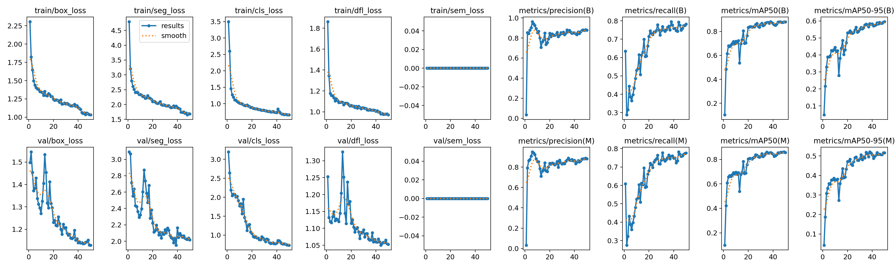
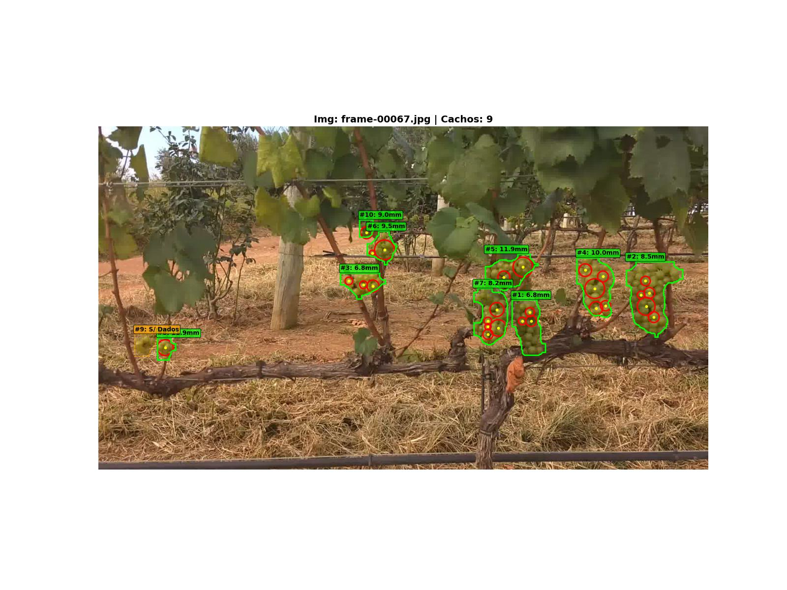

# E2 — Dados preparados e primeira adaptação

**Projeto:** SmartVine (G02) — segmentação de cachos e medição de bagas de uva com YOLOv8n-seg no WGISD  
**Equipe:** Marilio Cavalcanti de Moura · José Antonio  
**Datas:** 22/11/2026 (versionamento no Git, Pull Request) · 23/11/2026 (alinhamento com o professor)

Este repositório reúne a entrega da E2: o notebook usado no treino, os dados, os pesos gerados, os baselines e os resultados.

## Estrutura do repositório

```
g02-smartvine-ia/
├── README.md                     # este documento (entrega completa da E2)
├── RELATORIO_PROGRESSO.md        # relato curto para o alinhamento com o professor
├── PR_E2.md                      # texto do Pull Request
├── requirements.txt
├── notebooks/
│   └── uva_testes_bagas.ipynb    # notebook usado: preparação, treino, bagas, inferência e ONNX
├── data/
│   ├── README.md                 # origem e licença dos dados
│   ├── imagens/                  # só README: onde obter as 300 imagens do WGISD (não versionadas)
│   ├── labels/                   # só README: formato e origem das labels (não versionadas)
│   └── b1_ajuste.txt             # 23 imagens de treino usadas para ajustar o baseline B1
├── src/                          # avaliação: evaluate, baseline_hsv, metrics, berries
├── weights/
│   ├── README.md                 # hashes e licenças
│   └── best.pt · best.onnx       # modelo gerado no treino
└── resultados/
    ├── metricas/                 # JSON/CSV de B0, B1 e do modelo ajustado
    ├── figuras/                  # comparação entre métodos e exemplo qualitativo
    ├── treino_ft0/               # args.yaml, results.csv, curvas e matrizes do treino
    └── bagas/                    # saída do módulo de bagas
```

---

## Sumário

1. [Dados: limpeza, rotulagem, pré-processamento e partições](#1-dados)
2. [Baseline nas mesmas condições de teste](#2-baseline)
3. [Fine-tuning inicial](#3-fine-tuning-inicial)
4. [Resultados, limitações e próximo passo](#4-resultados-limitações-e-próximo-passo)
5. [Instruções de execução](#5-instruções-de-execução)
6. [Origem dos dados, pesos e licenças](#6-origem-dos-dados-pesos-e-licenças)
7. [Checklist do material esperado](#7-checklist-do-material-esperado)

---

## 1. Dados

### 1.1 Origem

| Item | Valor |
|---|---|
| Conjunto | Embrapa Wine Grape Instance Segmentation Dataset (WGISD) |
| Autores | Santos, T. T.; de Souza, L. L.; dos Santos, A. A.; Avila, S. |
| Repositório | https://github.com/thsant/wgisd |
| DOI | [10.5281/zenodo.3361736](https://doi.org/10.5281/zenodo.3361736) |
| Licença | CC BY-NC 4.0 (uso não comercial, com atribuição) |
| Conteúdo | 300 imagens, 5 variedades (CDY, CFR, CSV, SVB, SYH) |

Detalhes em [`data/README.md`](data/README.md).

### 1.2 Limpeza

Não foi necessária limpeza: as imagens e as labels vieram prontas do repositório. O notebook ([`uva_testes_bagas.ipynb`](notebooks/uva_testes_bagas.ipynb), seções 1 e 2) só confere se as pastas `images/` e `labels/` existem e se cada imagem listada em `train.txt` e `test.txt` está na pasta. Resultado: **300 imagens encontradas**, nenhuma ausente.

### 1.3 Rotulagem

A rotulagem veio do repositório: uma label YOLO-seg (`.txt`) por imagem, com os polígonos de cada cacho e uma classe (cacho de uva). Nenhuma anotação foi feita ou alterada pela equipe. Formato e origem em [`data/labels/README.md`](data/labels/README.md).

Na avaliação ([`src/evaluate.py`](src/evaluate.py)) a referência é a anotação original do WGISD: caixas (`.txt`) nas 58 imagens de `test.txt` e máscaras (`.npz`) nas 27 imagens de `test_masked.txt`.

> As imagens e labels **não são versionadas** neste repositório (tamanho e licença CC BY-NC 4.0). Elas são obtidas do repositório oficial do WGISD conforme a §5.

### 1.4 Pré-processamento

Feito pelo Ultralytics durante o treino (valores em [`args.yaml`](resultados/treino_ft0/args.yaml)):

- letterbox para 640 px e normalização;
- augmentações: HSV (h 0,015 · s 0,7 · v 0,4), translação 0,1, escala 0,5, flip horizontal 0,5, mosaic 1,0 (desligado nas 10 épocas finais), RandAugment e random erasing 0,4.

### 1.5 Partições

Foram usadas as partições originais do repositório, como no artigo (Santos et al., 2020):

| Partição | Imagens | Arquivo |
|---|---|---|
| Treino | **242** | `train.txt` |
| Teste | **58** | `test.txt` |

No notebook (seção 2), essas listas são convertidas em `yolo_train.txt` e `yolo_test.txt` com os caminhos completos das imagens.

**Justificativa:** é o mesmo particionamento do artigo-base, o que permite comparar com a literatura. A divisão é por imagem e nenhuma imagem aparece nas duas listas.

**Validação (protocolo equivalente):** o WGISD não traz partição de validação, e nesta primeira execução não foi criada uma. No `wgisd.yaml`, o campo `val` aponta para `yolo_test.txt`, então as métricas por época do Ultralytics (`results.csv`) são calculadas no próprio teste e servem **apenas para monitorar** o treino. Isso não alterou a escolha do modelo:

- não houve early stopping (as 50 épocas rodaram até o fim, `patience = 20`);
- o `best.pt` é a **época 50**, a última, que também é a de maior *fitness* no `results.csv`; o checkpoint seria o mesmo sem validação;
- nenhum hiperparâmetro do FT-0 foi escolhido olhando o teste.


---

## 2. Baseline

### 2.1 Referências avaliadas

| ID | Descrição | Ajuste |
|---|---|---|
| **B0** | YOLOv8n-seg pré-treinado no COCO, **sem ajuste** (qualquer detecção conta como cacho) | nenhum |
| **B1** | Regra de cor HSV + morfologia + componentes conexos | grade de 32 combinações escolhida em 23 imagens de treino ([`data/b1_ajuste.txt`](data/b1_ajuste.txt)) |

Melhor configuração do B1 ([`b1_hsv_params.json`](resultados/metricas/b1_hsv_params.json)): H verde 20–50, S ≥ 80, V escuro ≤ 60, S escuro ≥ 30, kernel 13, área mínima 0,2% da imagem. F1 nas imagens de ajuste = 0,079.

### 2.2 Como foi gerado

- **Código:** [`src/evaluate.py`](src/evaluate.py) roda os três métodos (B0, B1 e o modelo ajustado) com o mesmo procedimento. [`src/baseline_hsv.py`](src/baseline_hsv.py) implementa a regra HSV e a busca em grade. [`src/metrics.py`](src/metrics.py) faz o casamento e calcula P, R e F1.
- **Comando:** `python src/evaluate.py --wgisd ../wgisd --tune-b1 --methods b0 b1 ft --weights weights/best.pt`
- **Ambiente:** CPU Intel Xeon 2,9 GHz (2 vCPU), Python 3.13, ultralytics 8.4.216. Data: 21/11/2026.
- **Saídas:** [`resultados/metricas/`](resultados/metricas/) (um JSON por método e conjunto, mais `comparacao.csv`) e as figuras em [`resultados/figuras/`](resultados/figuras/).

### 2.3 Condições de teste (as mesmas para todos os métodos)

- **Conjuntos:** as 58 imagens de `test.txt` e, dentro delas, as 27 de `test_masked.txt` .
- **Casamento:** um-para-um guloso por confiança, IoU ≥ 0,5.
- **Inferência:** 640 px, `conf = 0,25`, máscaras na resolução original.

---

## 3. Fine-tuning inicial

### 3.1 Código e configuração

| Item | Arquivo |
|---|---|
| Notebook usado no treino | [`notebooks/uva_testes_bagas.ipynb`](notebooks/uva_testes_bagas.ipynb) |
| Configuração exata do treino | [`resultados/treino_ft0/args.yaml`](resultados/treino_ft0/args.yaml) |

O notebook tem 5 etapas:

1. **Setup:** caminhos, checagem da GPU e das pastas `images/` e `labels/`.
2. **Preparação do dataset:** gera `yolo_train.txt` e `yolo_test.txt` a partir de `train.txt` e `test.txt`.
3. **Treino:** `YOLO('yolov8n-seg.pt').train(...)` com os hiperparâmetros da §3.3.
4. **Bagas:** algoritmo geométrico que localiza as bagas dentro de cada máscara de cacho e mede o diâmetro.
5. **Análise, inferência e exportação:** análise das bagas por cacho, inferência em imagens novas (`conf = 0,50`) e exportação do `best.pt` para ONNX.

### 3.2 Parâmetros ajustados

- **Modelo base:** `yolov8n-seg.pt` (COCO).
- **Estratégia:** fine-tuning **completo**: backbone, neck e cabeça.
- **Cabeça:** trocada de 80 classes para **1** (cacho de uva).
- **Tamanho:** 3.258.259 parâmetros, 11,3 GFLOPs, 86 camadas (modelo fundido).

### 3.3 Hiperparâmetros

| Hiperparâmetro | Valor |
|---|---|
| Épocas | 50 (patience 20) |
| Batch | 32 |
| Resolução | 640 px |
| Otimizador | `optimizer=auto` → AdamW, lr 0,002, momentum 0,9 |
| `lr0` / `lrf` | 0,01 / 0,01 (com `optimizer=auto`, o Ultralytics ignora o `lr0` e usa o lr 0,002 acima) |
| Weight decay | 5e-4 |
| Warmup | 3 épocas (momentum 0,8, bias lr 0,1) |
| Perdas (pesos) | box 7,5 · cls 0,5 · dfl 1,5 |
| Máscaras | `overlap_mask=True`, `mask_ratio=4` |
| AMP | sim |
| Semente | 0, `deterministic=True` |
| `close_mosaic` | 10 |
| Workers | 8 |
| Augmentações | ver §1.4 |

### 3.4 Ambiente

| Item | Valor |
|---|---|
| Sistema | Windows, ambiente virtual Python local (`env_uva`) |
| GPU | NVIDIA RTX 4000 Ada (20 GB), 1 dispositivo CUDA |
| CPU | Intel Xeon |
| Bibliotecas | Ultralytics 8.4 · pandas 2.3.3 · numpy 2.0.1 · opencv-python |
| Dados de treino | 242 imagens de `train.txt` |
| Tempo total | 0,053 h ≈ 189 s (50 épocas) |
| Inferência na GPU | 1,0 ms por imagem (+ 0,1 ms de pré e 1,6 ms de pós-processamento) |
| Checkpoint | época 50 (`weights/best.pt`) |

### 3.5 Evidências de execução

- **Log por época:** [`resultados/treino_ft0/results.csv`](resultados/treino_ft0/results.csv) (50 linhas: perdas, métricas e taxa de aprendizado).
- **Curvas e matrizes:** [`resultados/treino_ft0/figuras/`](resultados/treino_ft0/figuras/) (`results.png`, curvas P/R/F1/PR de caixa e máscara, matriz de confusão, amostras de batch).
- **Saída completa do treino:** no próprio notebook, célula da seção 3.
- **Pesos:** [`weights/best.pt`](weights/) e `best.onnx`.

| Época | box_loss | seg_loss | cls_loss | dfl_loss | Tempo acumulado (s) |
|---|---|---|---|---|---|
| 1 | 2,308 | 4,799 | 3,502 | 1,863 | 7 |
| 10 | 1,346 | 2,336 | 1,012 | 1,090 | 39 |
| 20 | 1,247 | 2,095 | 0,886 | 1,062 | 75 |
| 30 | 1,183 | 1,967 | 0,796 | 1,038 | 109 |
| 40 | 1,135 | 1,891 | 0,727 | 1,007 | 144 |
| 50 | 1,032 | 1,680 | 0,659 | 0,972 | 189 |

Todas as perdas caem de forma consistente. A `seg_loss` cai 65% e a `cls_loss` 81% entre a primeira e a última época.



---

## 4. Resultados, limitações e próximo passo

### 4.1 Resultados medidos (21/11/2026)

Condições da §2.3: IoU ≥ 0,5, `conf = 0,25`, 640 px.

| Método | test_masked (27 img, 408 cachos) · máscara P / R / **F1** | test_masked · máscara mAP50 / mAP50-95 | test (58 img, 850 cachos) · caixa P / R / **F1** | Erro médio de contagem (cachos/img, test) |
|---|---|---|---|---|
| B0: YOLOv8n-seg COCO sem ajuste | 0,818 / 0,022 / **0,043** | 0,117 / 0,049 | 0,737 / 0,016 / **0,032** | 14,33 |
| B1: regra HSV | 0,118 / 0,061 / **0,081** | — | 0,106 / 0,055 / **0,073** | 8,21 |
| **FT-0: YOLOv8n-seg ajustado** | 0,767 / 0,809 / **0,788** | **0,857 / 0,544** | 0,737 / 0,793 / **0,764** | **2,16** |

Contagens brutas (TP / FP / FN):

| Método | test_masked · máscara | test_masked · caixa | test · caixa | s/img em CPU (test_masked · test) |
|---|---|---|---|---|
| B0 | 9 / 2 / 399 | 10 / 1 / 398 | 14 / 5 / 836 | 1,22 · 0,12 |
| B1 | 25 / 187 / 383 | 20 / 192 / 388 | 47 / 395 / 803 | 0,33 · 0,13 |
| FT-0 | 330 / 100 / 78 | 322 / 108 / 86 | 674 / 241 / 176 | 0,34 · 0,14 |

mAP do FT-0 em caixa no `test_masked`: mAP50 0,868 · mAP50-95 0,592.

Fontes: [`comparacao.csv`](resultados/metricas/comparacao.csv), [`map_test_masked_ultralytics.json`](resultados/metricas/map_test_masked_ultralytics.json) e os JSON de cada método em [`resultados/metricas/`](resultados/metricas/).


### 4.2 Módulo de bagas

Saída em [`resultados/bagas/`](resultados/bagas/) para o `frame-00067` do WGISD:

| Arquivo | Gerado por | Unidade |
|---|---|---|
| [`medidas_bagas.csv`](resultados/bagas/medidas_bagas.csv) | `src/berries.py` (sem `--px-per-mm`) | **px** (diâmetro médio, mínimo e máximo por cacho) |
| [`dados_frame-00067.csv`](resultados/bagas/dados_frame-00067.csv) | notebook, seção 5 | mm, com a escala do notebook (`PIXELS_POR_CM = 42`) |
| [`visual_frame-00067.jpg`](resultados/bagas/visual_frame-00067.jpg) | `src/berries.py` | imagem anotada |



Nessa imagem, o diâmetro medido varia de 20 px a 62 px entre as bagas detectadas.

### 4.3 Leitura

- **B0:** o COCO não tem a classe "uva". O modelo quase não detecta cachos (revocação de 0,02); a precisão alta vem de só 11 detecções em 27 imagens.
- **B1:** a regra de cor confunde folhas e cachos verdes (precisão de 0,12).
- **FT-0:** o fine-tuning eleva o F1 de máscara de 0,043 (B0) e 0,081 (B1) para **0,788**, e o erro de contagem cai de 14,3 e 8,2 para **2,2 cachos por imagem**. Precisão e revocação ficam equilibradas (0,77 / 0,81).
- **Literatura:** o Mask R-CNN de Santos et al. (2020) tem F1 ≈ 0,91 no WGISD. O protocolo não é idêntico, então esse valor é uma referência, não uma comparação direta.
- **Latência:** 1 ms por imagem na GPU e cerca de 0,14 s em CPU (2 vCPU), o que viabiliza a aplicação web.

### 4.4 Limitações

| # | Limitação |
|---|---|
| 1 | **Diâmetro das bagas:** o resultado principal está em px. Os valores em mm do notebook usam uma escala fixa (`PIXELS_POR_CM = 42`), sem calibração, e o módulo não foi comparado com anotações de bagas |
| 2 | **Sem partição de validação própria:** o `val` do treino é o próprio teste, usado só para monitorar (ver §1.5) |
| 3 | **Treino único:** o modelo foi treinado uma única vez (semente 0), sem repetição com outras sementes nem variação de hiperparâmetros |
| 4 | **Caminhos fixos no notebook** (`E:\Projeto_Uva\...`): precisam ser ajustados à mão (ver §5.1) |
| 5 | **Abaixo da referência da literatura:** F1 de máscara 0,788 contra ≈ 0,91 do Mask R-CNN de Santos et al. (protocolo não idêntico) |

Essas limitações estão registradas, mas não fazem parte do escopo da E3. Serão tratadas apenas se houver tempo após a aplicação web.

### 4.5 Próximo passo até a E3 (29/11/2026)

| Ação | Critério de pronto |
|---|---|
| Primeira versão da aplicação web com o `best.onnx` | Upload → máscara → tabela CSV |


---

## 5. Instruções de execução

### 5.1 Treino (notebook `uva_testes_bagas.ipynb`)

1. Crie o ambiente: `python -m venv env_uva` e `pip install -r requirements.txt`.
2. Baixe o WGISD (`git clone --depth 1 https://github.com/thsant/wgisd.git`) e organize os dados (as pastas [`data/imagens/`](data/imagens/) e [`data/labels/`](data/labels/) deste repositório só documentam a origem; os arquivos não são versionados):
   - imagens `.jpg` de `wgisd/data/` em `<PASTA_LOCAL>/images/`;
   - labels YOLO-seg (`.txt`, formato em [`data/labels/README.md`](data/labels/README.md)) em `<PASTA_LOCAL>/labels/`;
   - `train.txt` e `test.txt` do WGISD em `<BASE_DATASETS>/`.
3. Na seção 1 do notebook, ajuste `PROJETO_DIR`, `PASTA_LOCAL` e `BASE_DATASETS` (no original: `E:\Projeto_Uva\...`).
4. Rode a seção 2: ela gera `yolo_train.txt`, `yolo_test.txt` e o `wgisd.yaml` em `PROJETO_DIR` (`train: yolo_train.txt`, `val: yolo_test.txt`, classe `0: uva`). Ver §1.5 sobre o uso do teste como `val`.
5. Rode as células na ordem: setup → preparação → treino → bagas → análise/inferência → exportação ONNX.
6. Os pesos saem em `PROJETO_DIR/wgisd_treino_baga/weights/best.pt` (cópia em [`weights/best.pt`](weights/)).

### 5.2 Baselines e avaliação (a partir da raiz do repositório)

```bash
pip install -r requirements.txt

# Repositório do WGISD com train.txt, test.txt e test_masked.txt
git clone --depth 1 https://github.com/thsant/wgisd.git ../wgisd

# B0, B1 e modelo ajustado nas mesmas condições
python src/evaluate.py --wgisd ../wgisd --tune-b1 --methods b0 b1 ft --weights weights/best.pt

# Módulo de bagas (diâmetro em px; use --px-per-mm se houver escala)
python src/berries.py --weights weights/best.pt --source ../wgisd/extra/video_demo_frames/frame-00067.jpg
```

---

## 6. Origem dos dados, pesos e licenças

| Item | Onde | Licença |
|---|---|---|
| WGISD (imagens, listas e anotações) | https://github.com/thsant/wgisd; registro em [`data/README.md`](data/README.md) | CC BY-NC 4.0 |
| Imagens e labels usadas | não versionadas; origem documentada em [`data/imagens/`](data/imagens/README.md) e [`data/labels/`](data/labels/README.md) | CC BY-NC 4.0 |
| `weights/best.pt` (6,8 MB) · `best.onnx` (13,4 MB) | nesta pasta | AGPL-3.0 (Ultralytics) + uso não comercial (WGISD) |

Hashes e detalhes em [`weights/README.md`](weights/README.md).

---

## 7. Checklist do material esperado

- [x] Repositório atualizado (notebook, código de avaliação, relatórios nesta pasta)
- [x] Limpeza, rotulagem e pré-processamento documentados (§1.2–1.4)
- [x] Partições de treino e teste justificadas, com o protocolo de validação explicado (§1.5)
- [x] Baseline comparável avaliado nas mesmas condições de teste (§2, §4.1)
- [x] Fine-tuning inicial: código, configuração, parâmetros ajustados, hiperparâmetros e ambiente (§3.1–3.4)
- [x] Evidências de execução: log, curvas e métricas (§3.5)
- [x] Primeiros resultados, limitações e próximo passo até a E3 (§4)
- [x] Instruções de execução (§5)
- [x] Registro da origem dos dados (§1.1, §6)
- [x] Pesos entregues de forma permitida pela licença (§6)
- [x] Relatório de progresso: [`RELATORIO_PROGRESSO.md`](RELATORIO_PROGRESSO.md)
- [x] Texto do Pull Request: [`PR_E2.md`](PR_E2.md)

